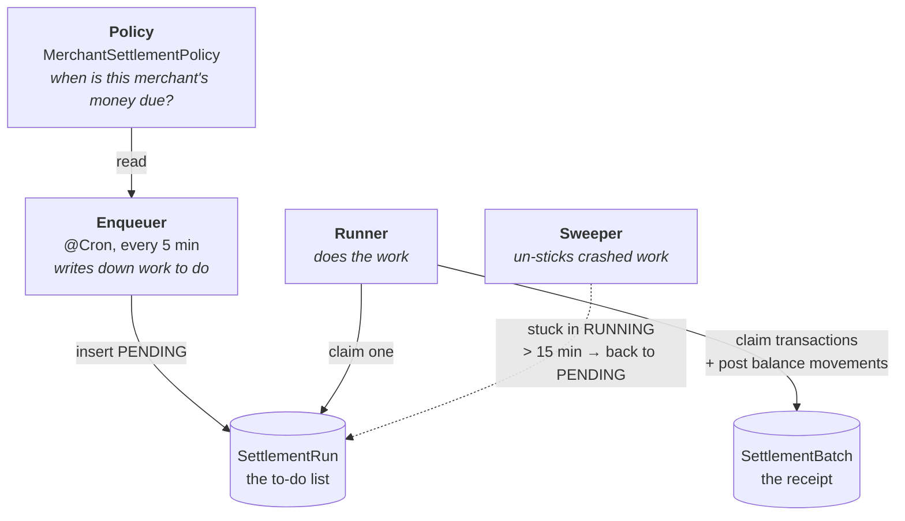
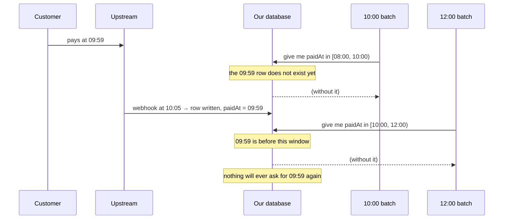
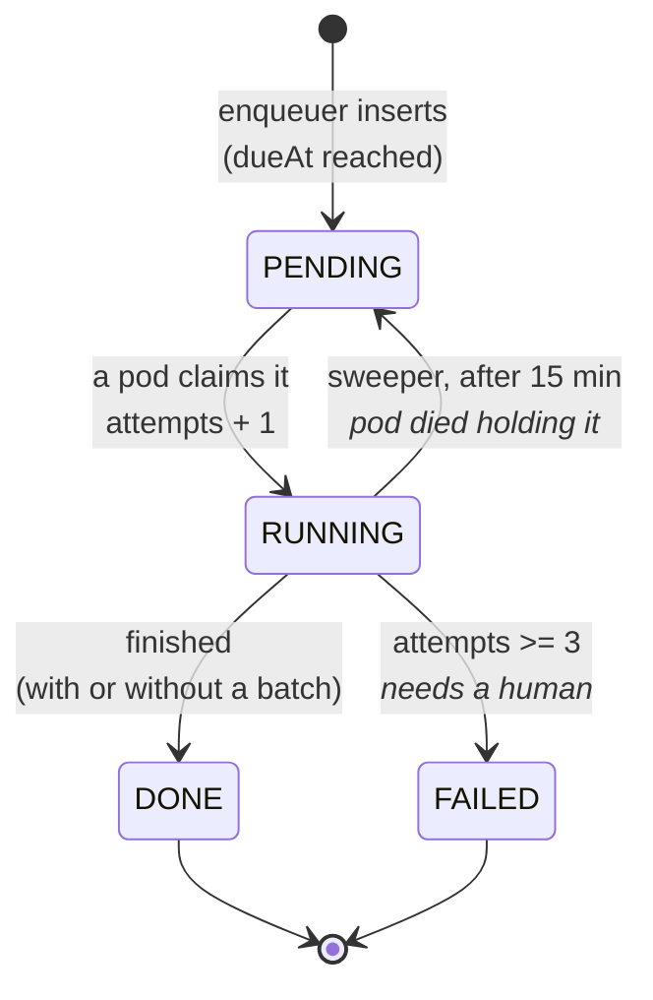

# Settlement and Batching, Explained

No background assumed. This is the "what is actually going on" document for
`apps/settlement` — the claim, the batch, the enqueuer, the sweeper, and how
they fit together.

Companion to [balance-explained.md](balance-explained.md), which covers the
money model this one moves, and to
[settlement-policy-explained.md](settlement-policy-explained.md), which covers
the rules deciding *when* it should move. Read that first if `PENDING` / `AVAILABLE` /
`RESERVED` are not yet solid, because settlement is **the only thing in the
system that moves money from `PENDING` to `AVAILABLE`** — that is its entire
job, and the rest of this document is the machinery around that one sentence.

The design docs beside this one say *why*:
[settlement-batching.md](settlement-batching.md) is the shape,
[settlement-batching-implementation.md](settlement-batching-implementation.md)
is the build order. This one is for the mental picture, and §11 is for checking
the running system yourself.

---

## 1. First: "claim" means two different things

This is the single biggest source of confusion, and it is worth clearing before
anything else. The word **claim** is used for two unrelated mechanisms:

| Phrase | What is claimed | By what | Purpose |
|---|---|---|---|
| "claim a **run**" | a `SettlementRun` row | one **pod** (one running copy of the app) | *"I am working on this, nobody else start it"* |
| "claim **transactions**" | `PurchaseTransaction` rows | one **batch** | *"these are settled, nobody settle them again"* |

They look alike — both use `FOR UPDATE SKIP LOCKED`, both set a column to say
"taken" — and they solve different problems:

- The **run claim** is a *lease*. It stops two pods duplicating effort. If it
  failed, the system would still be correct, just wasteful.
- The **transaction claim** is a *correctness guarantee*. It is what makes
  double-settling impossible. If it failed, merchants would be paid twice.

> **Keep them apart in your head.** One is about not wasting work. The other is
> about not losing money.

Everything else in this document is easier once that split is clear.

---

## 2. The four moving parts



In words:

1. **Policy** — per merchant, per payment method: `INSTANT`,
   `FOLLOW_UPSTREAM`, `FIXED_DELAY`, or `SCHEDULED`. Already built (Step 9).
   Answers *"when does this merchant's money become theirs to spend?"*
2. **Enqueuer** — a cron that does **no work**. It only writes `SettlementRun`
   rows saying "merchant 27's money was due at 15:00, somebody settle it".
3. **Runner** — picks up one run at a time and actually settles: claims
   transactions, posts balance movements, writes a batch row.
4. **Sweeper** — a cron that finds runs a pod started and never finished, and
   puts them back on the list.

**Why separate the enqueuer from the runner?** Because "deciding what needs
doing" and "doing it" fail differently. If the runner crashes, the work is still
written down and another pod picks it up. If the two were one job, a crash would
lose both the work *and* the record that it was needed.

---

## 3. What actually triggers them

Nothing pushes. The enqueuer inserting a `SettlementRun` row does not notify
anybody — a Postgres row just sits there waiting to be noticed. So **each of the
three parts needs its own cron.** Three jobs, not two:

| Service | Cron | What one tick does |
|---|---|---|
| `EnqueuerService` | `EVERY_10_MINUTES` (on `:00`) | read policies, write the `SettlementRun` rows now due |
| `RunnerService` | `'30 */2 * * * *'` | claim a run, settle it, **repeat until no runs are left** |
| `SweeperService` | `'45 */5 * * * *'` | return runs stuck in `RUNNING` for >15 min to `PENDING` |

**Those offsets are load-bearing, not fussiness.** The runner started on
`EVERY_5_MINUTES` and shared every single enqueuer tick — losing it every
time, because its claim query committed before the enqueuer's insert did. Work
enqueued at 17:40:00 sat `PENDING` until 17:45. Half a minute past the boundary
fixed it: 18:10:00 enqueued, 18:10:30 settled. See *Why the schedules are
offset* in Step 11 of the implementation guide for the measurements.

### The runner's tick is "drain the queue", not "do one run"

This is the part worth getting right. If one tick handled a single run, fifty
merchants all due at 15:00 would take fifty ticks — nearly an hour at a
one-minute cadence, for work that takes seconds.

So the shape is: the cron **wakes** the runner, the runner **drains**, then it
sleeps until the next tick.

```ts
@Cron(CronExpression.EVERY_MINUTE, { name: 'runner', waitForCompletion: true })
async drain(): Promise<void> {
  let settled = 0;

  // Bounded so one tick cannot hold the process indefinitely. Not a
  // correctness bound: the loop ends on its own once the claim finds nothing.
  for (let taken = 0; taken < MAX_RUNS_PER_TICK; taken += 1) {
    const run = await this.claimOneRun();   // the UPDATE ... SKIP LOCKED in §5
    if (!run) break;                        // nothing due - done for this tick

    try {
      await this.settlementService.settle(run);
      await this.markDone(run.id);
    } catch (error) {
      // Leave it RUNNING. The sweeper returns it to PENDING after 15 minutes,
      // and `attempts` is what eventually marks it FAILED. Do not rethrow: one
      // broken merchant must not stop the drain for everyone else.
      this.logger.error({ msg: 'run failed', runId: run.id, error });
    }

    settled += 1;
  }

  if (settled > 0) this.logger.log({ msg: 'drain complete', settled });
}
```

> **The cron interval sets the worst-case *latency*, not the throughput.** How
> much work gets done per tick is decided by the loop, not the schedule.

### Silence is not proof of life

All three jobs return early when there is nothing to do, which over a quiet
fifteen minutes produced exactly one log line — a dead cron and an idle one
look identical. So each logs at `debug` every idle tick, and at `log` level once
every thirty idle minutes. Both levels, because production runs at `info` and a
debug-only heartbeat would be invisible exactly where "did it run?" matters.
One `CronHeartbeat` derives each job's announce cadence from its tick interval,
so all three go quiet for about the same wall-clock time.

### `waitForCompletion`, or you overlap yourself

`@Cron` does **not** wait for the previous invocation to finish. A drain taking
three minutes on a one-minute cron would have three copies running inside the
same pod.

`cron@4.4.0`, which `@nestjs/schedule@12` wraps, takes a flag for exactly this:

```ts
{ name: 'runner', waitForCompletion: true }
```

> *"If true, no additional instances of cronjob will run until the current onTick
> callback has completed. Any new scheduled executions that occur while the
> current cronjob is running will be skipped entirely."*

Worth putting on the sweeper too. The enqueuer is fast enough not to need it,
and it costs nothing there either. Without the flag you need a manual
`private isRunning = false` guard, which works and is one more thing to forget.

### Picking the intervals

Worst-case lateness is the two intervals added together:

```
15:00   merchant's money becomes due
15:10   enqueuer tick writes the run        (+10 min — enqueuer interval)
15:11   runner tick claims and settles it   (+1 min  — runner interval)
```

Eleven minutes late. For policies measured in **days**, that is irrelevant —
which is why a ten-minute enqueuer is fine. Want it sharper? Shorten the
enqueuer; the runner is already cheap because an empty drain is one indexed
query that returns nothing.

**The sweeper's interval must be shorter than the 15-minute stale threshold**,
or a crashed run sits idle longer than it needs to. Every five minutes gives
three chances per window.

### "Could the enqueuer just call the runner directly?"

It could, and it would mostly work. Two reasons not to:

- **A run the sweeper rescues** would wait for the next *enqueuer* tick to be
  retried, instead of being picked up on the next runner tick. Making crashes
  heal quickly is the sweeper's entire purpose, and fusing the two blunts it.
- **They fail differently**, which is §2's point. If settling throws inside the
  enqueuer, you lose the record that the work was needed along with the work.

Keeping them apart costs one decorator and buys independent failure.

### All three run on both pods, and that is fine

Worth restating, because "two pods both running the same cron" sounds like a
bug:

- **Enqueuer** — both pods insert the same run; the second loses on
  `@@unique([merchantId, paymentMethodName, dueAt])`. Catch `P2002`, move on.
- **Runner** — `FOR UPDATE SKIP LOCKED` means the second pod takes a *different*
  run rather than queueing behind the first. Two pods draining in parallel is
  the design working.
- **Sweeper** — resetting an already-reset run is a no-op.

---

## 4. The one idea everything rests on

### The obvious way, and why it breaks

The natural way to settle a day's payments is by time window:

```sql
-- settle everything paid between 08:00 and 10:00   ← don't
WHERE "paidAt" >= '08:00' AND "paidAt" < '10:00'
```

Now follow one payment. A customer pays at **09:59**. The provider's webhook
reaches us at **10:05** — six minutes late, which is completely normal.

The 10:00 batch ran at 10:00. It looked for rows with `paidAt` between 08:00 and
10:00. At that moment our 09:59 payment **was not in the database yet**, so the
batch did not see it.

The next batch covers 10:00–12:00. Our payment has `paidAt = 09:59`, which is
outside that window. It is not in the 12:00 batch either.



**That payment is now invisible to every future batch.** The merchant never gets
the money, nothing errors, and nobody finds out until they complain. Widening
the window to "catch late arrivals" means overlapping windows, which means
paying some transactions twice — trading a silent loss for a silent duplicate.

### The claim way

Stop asking *"when was this paid?"* and start asking *"has anybody settled this
yet?"*

```sql
WHERE "batchSettlementId" IS NULL        -- ← this line is the whole trick
```

`PurchaseTransaction.batchSettlementId` is `NULL` for every transaction that has
never been settled. Claiming it means filling that column in. So:

- A payment that arrives six minutes late is simply **still unclaimed**. The
  next run picks it up. Being late costs it nothing.
- A payment that has been settled has a non-`NULL` value, and **no query will
  ever match it again**. Settling twice is not "unlikely", it is not expressible.

That one change dissolves a whole family of problems:

| Problem with time windows | With claims |
|---|---|
| Late webhook falls between two windows, lost forever | Still unclaimed, caught next run |
| Overlapping windows settle a payment twice | Second claim matches nothing |
| Pod crashes mid-batch — which rows were done? | Done rows are non-`NULL`; the rest are untouched |
| Re-running a batch to be safe | Harmless — it claims nothing |

> **The claim column is not an optimisation. It is the correctness mechanism.**
> Everything else — the run table, the sweeper, the retry logic — is allowed to
> be sloppy *because* this one column cannot be.

### It also makes retries free

Because claiming is "set a column that was `NULL`", running the same settlement
twice is safe by construction. That is what lets the sweeper be as blunt as it
is: it does not need to know what the dead pod finished, because the database
already does.

---

## 5. Why a run *table* instead of a lock

The enqueuer could be skipped entirely: just have every pod run a cron at 15:00
and use a Redis lock so only one wins. That is the usual answer, and it is worse
here.

### The Redis lock version

```
pod A: SET lock:settlement:27 mine NX EX 300   → wins, starts settling
pod B: SET lock:settlement:27 mine NX EX 300   → loses, does nothing
```

Problems, in order of how much they hurt:

1. **Redis cannot see whether your Postgres transaction succeeded.** It is a
   separate system holding an opinion about something it cannot observe. The
   lock can expire mid-work, or be held by a pod that already died.
2. **A crash leaves no record.** Pod A takes the lock, settles 300 of 1,200
   transactions, and dies. The lock expires in five minutes and... nothing knows
   a run was ever needed. The remaining 900 wait for tomorrow.
3. **"Did settlement run for merchant 27 yesterday?"** is unanswerable. There is
   nothing to query.

### The run table version

The work is a **row**, written down before anyone does it:

```
SettlementRun
 id | merchantId | paymentMethodName | dueAt | status  | claimedBy | claimedAt | attempts
 41 | 27         | *                 | 15:00 | PENDING | null      | null      | 0
```

A pod takes work by **changing the row**:

```sql
UPDATE "settlement"."SettlementRun"
SET "status" = 'RUNNING', "claimedBy" = $pod, "claimedAt" = now(),
    "attempts" = "attempts" + 1
WHERE "id" = (
  SELECT "id" FROM "settlement"."SettlementRun"
  WHERE "status" = 'PENDING' AND "dueAt" <= now()
  ORDER BY "dueAt"
  FOR UPDATE SKIP LOCKED
  LIMIT 1
)
RETURNING *;
```

Now:

1. **The claim and the work are in the same database.** They can be in the same
   transaction. If the transaction rolls back, the claim rolls back with it.
2. **A crash leaves evidence.** The row sits in `RUNNING` with a `claimedAt`
   timestamp and a `claimedBy` pod name. The sweeper finds it precisely because
   it is still there.
3. **History is queryable.** Every run that ever happened, when it was due, who
   took it, whether it finished, how many times it was tried.

You still have a lock — it just lives in the database next to the thing it
protects, instead of in a separate system guessing.

### A run's whole life



The loop in the middle is the important part: `RUNNING → PENDING` is how a pod
crash heals itself, and `attempts` is what stops that loop spinning forever on a
merchant who genuinely cannot be settled.

Note what is **not** on this diagram: there is no transition for "settled some
but not all". A run is `DONE` when the claim stops returning rows, and partial
progress needs no state of its own because the progress is recorded on the
transactions themselves (§4).

### `FOR UPDATE SKIP LOCKED`, plainly

> *"Give me a row nobody else is working on right now, and don't sit there
> waiting if one is busy — skip it and take the next."*

Without `SKIP LOCKED`, pod B would **wait** for pod A to finish, then take the
same row. With it, pod B skips past and grabs a different run, so two pods do
two merchants in parallel instead of queueing on one.

`LIMIT 1` inside the subquery plus the `UPDATE` outside it means Postgres
guarantees exactly one pod wins each row. There is no window between checking
and taking — it is one statement.

---

## 6. Two different gates, and why you need both

This confused me when writing it, so it is worth being explicit.

| Gate | Question | Where it lives |
|---|---|---|
| `dueAt <= now()` | *"Is it time to go look at this merchant?"* | on `SettlementRun` |
| the eligibility predicate | *"Which of this merchant's transactions are ripe?"* | in the claim's `WHERE` |

They are not the same question, and a run does **not** mean "settle everything
this merchant has".

Concretely: merchant 27 is `FOLLOW_UPSTREAM` on MotionPay QRIS, so a payment
settles the day after at 15:00. A run becomes due at 15:00 today. At that moment
the merchant has:

- a payment from **yesterday** 09:00 → due today 15:00 → **eligible**
- a payment from **yesterday** 23:50 → due today 15:00 → **eligible**
- a payment from **today** 11:00 → due *tomorrow* 15:00 → **not eligible**

The run fires once and claims the first two. The third stays `NULL` and is
picked up by tomorrow's run. If the claim had no eligibility filter, that third
payment would be settled a day early — we would pay the merchant money MotionPay
has not sent us yet.

So the policy is consulted **twice**, for two different purposes: the enqueuer
uses it to decide *when to create a run*, and the claim uses it to decide *which
rows to take*. That is why Step 9 had to come before Step 10.

---

## 7. A full worked example

Merchant 27, policy `FOLLOW_UPSTREAM` on `'*'`, MotionPay QRIS (T+1 at 15:00).
Agent 5 takes a share. It is **2026-10-15, 15:02**.

Three successful purchases exist, all with `batchSettlementId = NULL`:

| id | paidAt | nominal | netNominal | eligible at | ripe? |
|---|---|---|---|---|---|
| 123 | 2026-10-14 09:00 | 100,000 | 98,000 | 2026-10-15 15:00 | ✅ |
| 124 | 2026-10-14 23:50 | 50,000 | 49,000 | 2026-10-15 15:00 | ✅ |
| 125 | 2026-10-15 11:00 | 70,000 | 68,600 | 2026-10-16 15:00 | ❌ not yet |

Their balance entries from `PAYIN_CAPTURED` already sit in `PENDING` (this is
§6 of balance-explained). Merchant 27's `PENDING` is 98,000 + 49,000 + 68,600 =
**215,600**, and `AVAILABLE` is **0**.

### 15:00 — the enqueuer writes down the work

```
SettlementRun
 id | merchantId | paymentMethodName | dueAt            | status  | attempts
 41 | 27         | *                 | 2026-10-15 15:00 | PENDING | 0
```

The cron runs every 5 minutes on **both** pods. Both try to insert this row;
`@@unique([merchantId, paymentMethodName, dueAt])` means the second one fails
with `P2002`, which the enqueuer catches and ignores. One row, not two.

### 15:02 — a pod claims the run

```
 41 | ... | status = RUNNING | claimedBy = settlement-7d9f8b-xk2p4 | claimedAt = 15:02 | attempts = 1
```

The other pod's identical query returns nothing — `SKIP LOCKED` sent it past
this row, and there are no other due runs.

### 15:02 — the claim

The runner resolves the policy to a concrete cutoff (`paidAt < 2026-10-14
15:00`, i.e. anything from before yesterday afternoon is ripe) and runs the
claim with `LIMIT 500`:

```sql
UPDATE "transaction"."PurchaseTransaction"
SET "batchSettlementId" = 7, "settlementAt" = now()
WHERE "id" IN (
  SELECT "id" FROM "transaction"."PurchaseTransaction"
  WHERE "merchantId" = 27
    AND "status" = 'SUCCESS'
    AND "batchSettlementId" IS NULL
    AND "deletedAt" IS NULL
    AND ('*' = '*' OR "paymentMethodName" = '*')
    AND "paidAt" < '2026-10-14 15:00+07'      -- the eligibility predicate
  ORDER BY "paidAt"
  LIMIT 500
  FOR UPDATE SKIP LOCKED
)
RETURNING "id", "paidAt", "nominal", "netNominal";
```

Two rows come back — **123 and 124**. Row 125 is not eligible, so it was never
a candidate, and it is still `NULL`.

| id | batchSettlementId | settlementAt |
|---|---|---|
| 123 | **7** | 2026-10-15 15:02 |
| 124 | **7** | 2026-10-15 15:02 |
| 125 | `NULL` | `NULL` |

### 15:02 — post the balance movements

For each claimed purchase, the runner reads its `PurchaseFeeDetail` rows —
written back at webhook time — and builds **one movement per purchase**, moving
each holder's share from `PENDING` to `AVAILABLE`.

Purchase 123 (merchant 98,000 / internal 1,000 / agent 200):

| holder | bucket | dir | amount | reason | source |
|---|---|---|---|---|---|
| MERCHANT 27 | PENDING | DEBIT | 98,000.00 | MERCHANT_SETTLED | PURCHASE 123 |
| MERCHANT 27 | AVAILABLE | CREDIT | 98,000.00 | MERCHANT_SETTLED | PURCHASE 123 |
| INTERNAL 0 | PENDING | DEBIT | 1,000.00 | MERCHANT_SETTLED | PURCHASE 123 |
| INTERNAL 0 | AVAILABLE | CREDIT | 1,000.00 | MERCHANT_SETTLED | PURCHASE 123 |
| AGENT 5 | PENDING | DEBIT | 200.00 | MERCHANT_SETTLED | PURCHASE 123 |
| AGENT 5 | AVAILABLE | CREDIT | 200.00 | MERCHANT_SETTLED | PURCHASE 123 |

Purchase 124 gets its own six legs with its own numbers. **Note the `sourceId`
is the purchase, not the batch** — that matters in §8.

Merchant 27's snapshot now: `PENDING` 68,600, `AVAILABLE` 147,000. Purchase
125's money is still stuck in `PENDING`, which is correct — MotionPay has not
sent it to us yet.

### 15:02 — write the receipt

```
SettlementBatch
 id | runId | sweptFrom        | sweptTo          | transactionCount | grossAmount | feeAmount | netAmount
 7  | 41    | 2026-10-14 09:00 | 2026-10-14 23:50 | 2                | 150,000.00  | 3,000.00  | 147,000.00
```

`sweptFrom` / `sweptTo` are the **min and max `paidAt` of what was actually
claimed** — descriptive, derived afterwards. They are *not* a window the query
selected on. Nothing ever reads them to decide anything; they are there so a
human looking at a batch can see what period it covered.

### 15:02 — finish

```
 41 | ... | status = DONE | finishedAt = 15:02
```

All of the above — the claim, the balance movements, the batch row — happens in
**one** `$transaction`. If anything throws, all of it rolls back together:
`batchSettlementId` goes back to `NULL`, the balance entries vanish, no batch
row exists. The run stays `RUNNING` and the sweeper will pick it up.

### 15:07 — the next cron tick

The enqueuer looks at merchant 27. Their next release time is tomorrow 15:00, so
no new run is due. Nothing happens.

Had a run somehow been created and claimed again right now, the claim query
would match **zero rows** — 123 and 124 are no longer `NULL`, and 125 is not
eligible. It would finish `DONE` with no batch. That is a normal, healthy
outcome, not an error.

---

## 8. Three layers of protection against paying twice

The design looks redundant. It is not — each layer catches a different failure,
and they are listed here weakest-first:

**Layer 1 — the run's unique key.** `@@unique([merchantId, paymentMethodName,
dueAt])` means two pods enqueueing the same work produce one row. Catches
duplicate *scheduling*.

**Layer 2 — the transaction claim.** `batchSettlementId IS NULL` means a settled
transaction cannot be selected again, by anything, ever. Catches duplicate
*work*, and it is the layer that actually guarantees correctness.

**Layer 3 — the balance unique constraint.** `BalanceEntry` is unique on
`(holderType, holderId, bucket, reason, sourceType, sourceId)`. Because each
movement's `sourceId` is the **purchase id**, a second attempt to post
`MERCHANT_SETTLED` for purchase 123 hits `P2002` and throws. Catches duplicate
*money*, even if layers 1 and 2 were both bypassed by a bug.

> Layer 2 is the one to never weaken. If you are ever tempted to "re-settle" a
> transaction by nulling `batchSettlementId`, layer 3 will stop you — and that
> is the system telling you the money already moved.

---

## 9. When things go wrong

### A pod dies mid-run

Pod A claims run 41, settles 500 of 1,200 transactions in the first batch, and
is killed before the second.

The first batch's transaction *committed*, so those 500 are `batchSettlementId =
7` and their money is in `AVAILABLE`. Run 41 sits in `RUNNING` with
`claimedAt = 15:02` and nothing touching it.

The **sweeper** runs, sees `status = 'RUNNING' AND claimedAt < now() - 15
minutes`, and sets it back to `PENDING`. A pod claims it again (`attempts` → 2)
and runs the same claim query. The 500 already done are no longer `NULL`, so it
takes the remaining 700. Nothing is settled twice and nothing is lost.

**The sweeper is only safe because of §4.** It makes no attempt to work out what
the dead pod finished — it does not need to, because the claim column already
records that.

### The same merchant keeps failing

`attempts` increments on every claim. After `attempts >= 3` the sweeper marks
the run `FAILED` with a `failureReason` instead of returning it to `PENDING`, so
a genuinely broken merchant does not spin forever and hide other work. That run
now needs a human.

### Two pods somehow run the same merchant

Layer 1 should prevent it. If it happens anyway, the claim's own `FOR UPDATE
SKIP LOCKED` means the second pod's inner `SELECT` skips the rows the first has
locked, so it claims nothing and writes an empty batch. Wasteful, harmless.

### A merchant has 1,200 eligible transactions

The claim is capped at `LIMIT 500`. The runner loops:

| Iteration | Claimed | Batch |
|---|---|---|
| 1 | 500 | batch 7 |
| 2 | 500 | batch 8 |
| 3 | 200 | batch 9 |

Loop until a claim returns **fewer than the cap**. Three batches, one run —
which is why `SettlementRun` has `settlementBatches SettlementBatch[]` and not
one batch per run.

**Why cap at all?** A single transaction claiming 50,000 rows holds locks for a
long time and produces 300,000 balance entries in one commit. Capping keeps each
commit small and lets other pods work other merchants meanwhile.

### A webhook arrives after settlement

A payment is captured at 09:59 but its webhook lands at 15:03, one minute after
the run finished. The row is created with `batchSettlementId = NULL`, so it is
simply unclaimed, and tomorrow's run takes it. No window, nothing lost.

### A merchant has no policy row

The runner treats a missing policy as `FOLLOW_UPSTREAM`. A merchant registered
before Step 9 landed still gets paid. (Registration creates an explicit row now,
so this is a legacy path, not the normal one.)

---

## 10. The timestamps, because there are eight of them

Easy to mix up. Ordered by when they happen:

| Column | On | Means |
|---|---|---|
| `paidAt` | PurchaseTransaction | when the customer's money actually arrived |
| `dueAt` | SettlementRun | when this merchant's settlement *became due* |
| `createdAt` | SettlementRun | when the enqueuer wrote the run down — the gap from `dueAt` tells you if the enqueuer is late |
| `claimedAt` | SettlementRun | when a pod took the run. **The sweeper's input** |
| `settlementAt` | PurchaseTransaction | when this transaction was claimed into a batch |
| `postedAt` | SettlementBatch | when the batch row was written |
| `finishedAt` | SettlementRun | when the run completed, success or failure |
| `sweptFrom` / `sweptTo` | SettlementBatch | min/max `paidAt` of the claimed rows. **Descriptive only** |

Two traps:

- **`dueAt` is not `paidAt + delay`.** `dueAt` is a property of the *run* — "it
  is time to look at this merchant". Whether any individual transaction is ripe
  is the eligibility predicate's job (§6).
- **`sweptFrom`/`sweptTo` are outputs, not inputs.** Reading them as a window
  the claim used is exactly the time-window thinking §4 exists to replace.

---

## 11. How to check it yourself

### Did anything get settled twice?

```sql
SELECT "sourceId", "holderType", "holderId", "bucket", count(*)
FROM transaction."BalanceEntry"
WHERE "reason" = 'MERCHANT_SETTLED'
GROUP BY 1, 2, 3, 4
HAVING count(*) > 1;
```

**Must return zero rows.** The unique constraint makes it impossible, so a row
here means the constraint is missing.

### Does a batch's total match what it claimed?

```sql
SELECT b."id",
       b."transactionCount",
       count(p."id")         AS "actualCount",
       b."netAmount",
       sum(p."netNominal")   AS "actualNet"
FROM settlement."SettlementBatch" b
LEFT JOIN transaction."PurchaseTransaction" p ON p."batchSettlementId" = b."id"
GROUP BY b."id", b."transactionCount", b."netAmount"
HAVING count(p."id") <> b."transactionCount"
    OR coalesce(sum(p."netNominal"), 0) <> b."netAmount";
```

**Must return zero rows.** Any row means a batch's stated totals disagree with
the transactions actually carrying its id.

### Is anything stuck?

```sql
SELECT "id", "merchantId", "dueAt", "status", "claimedBy", "claimedAt", "attempts"
FROM settlement."SettlementRun"
WHERE "status" = 'RUNNING' AND "claimedAt" < now() - interval '15 minutes'
   OR ("status" = 'PENDING' AND "dueAt" < now() - interval '1 hour')
ORDER BY "dueAt";
```

The first condition is what the sweeper acts on. The second — `PENDING` and
long overdue — means the **runner** is not running at all, which the sweeper
will not fix.

### Is money waiting that should have moved?

```sql
SELECT "merchantId", count(*), sum("netNominal")
FROM transaction."PurchaseTransaction"
WHERE "batchSettlementId" IS NULL
  AND "status" = 'SUCCESS'
  AND "deletedAt" IS NULL
  AND "paidAt" < now() - interval '3 days'
GROUP BY "merchantId"
ORDER BY 3 DESC;
```

Three days unclaimed is longer than any current policy requires. Rows here mean
either a merchant has no run being created, or their runs keep failing.

### What happened in one run?

```sql
SELECT r."id" AS "runId", r."status", r."attempts",
       b."id" AS "batchId", b."transactionCount", b."netAmount"
FROM settlement."SettlementRun" r
LEFT JOIN settlement."SettlementBatch" b ON b."runId" = r."id"
WHERE r."id" = 41
ORDER BY b."id";
```

---

## 12. Implementing Step 10 — the order that actually works

One gap worth knowing before you start, because it bites immediately.

Step 10 says "claim with `$batchId`" and then, two steps later, "write the
`SettlementBatch` row". **You cannot do it in that order** — the claim needs a
batch id that does not exist yet.

Insert the batch row **first**, inside the transaction, with zero totals; use
its id for the claim; then update it with the real numbers:

```ts
await prisma.$transaction(async (tx) => {
  // 1. Reserve the id. Totals are zero and will be corrected below; nothing
  //    outside this transaction can see the row until it commits.
  const batch = await tx.settlementBatch.create({
    data: { runId, transactionCount: 0 },
    select: { id: true },
  });

  // 2. Claim, using that id.
  const claimed = await tx.$queryRaw<ClaimedRow[]>`...`;
  if (claimed.length === 0) return { batchId: null, claimed: 0 };

  // 3. Post one movement per purchase, through libs/balance, same tx.
  for (const row of claimed) await this.balanceService.post(tx, movement(row));

  // 4. Now the totals are known.
  await tx.settlementBatch.update({
    where: { id: batch.id },
    data: { transactionCount: claimed.length, grossAmount, feeAmount, netAmount,
            sweptFrom, sweptTo },
  });

  return { batchId: batch.id, claimed: claimed.length };
});
```

The alternative is reading `nextval` from the sequence by hand, which works but
means raw sequence access and a batch id that exists before its row. The
insert-then-update version keeps everything inside the model API.

**If the claim returns zero rows you must not leave the empty batch behind.**
Returning normally from inside `$transaction` **commits** — it does not roll
back — so the `return` in step 2 above would persist a batch with
`transactionCount: 0`. Most runs for most merchants claim nothing, so that is a
zero-row batch on nearly every tick. Two ways out:

- **Check before creating.** A cheap `SELECT "id" ... LIMIT 1` with the same
  predicate, before step 1. Costs one extra query per run and keeps the happy
  path obvious. The partial claim index makes it fast.
- **`tx.settlementBatch.delete()`** before returning. One statement, no extra
  query, but easy for a later edit to skip past.

**The implementation took the second.** One statement, no extra query on the
common path, and the comment above it says so — an empty-batch leak is
invisible until someone asks why there are 40,000 batches.

Other things the guide assumes you will work out:

- **`post()` must receive `tx`, not the root client.** `libs/balance` throws if
  handed a root `PrismaClient` — deliberately, so entries and snapshots cannot
  commit separately.
- **`createdBy` on the movements** is the settlement runner's machine id
  (`MACHINE_USER_ID.SCHEDULER_01`), passed explicitly. `BalanceEntry.createdBy`
  is NOT NULL and a cron has no request context to infer it from.
- **Resolve `FOLLOW_UPSTREAM` cutoffs in JavaScript first**, then pass them as
  query parameters. The window lookup is per (provider, method) and does not
  belong inside the claim's `WHERE`.
- **One movement per purchase, not one per batch.** It is what makes layer 3 of
  §8 work, and it is what lets you answer "what did settlement do to purchase
  123" with a single query.

---

## 13. Vocabulary

| Term | Meaning here |
|---|---|
| **Settlement** | Moving a merchant's money from `PENDING` to `AVAILABLE` |
| **Batch** | One commit's worth of settled transactions, capped at 500 |
| **Run** | One unit of scheduled work: settle merchant X, due at time T |
| **Claim (a run)** | A pod leasing a run so no other pod duplicates it |
| **Claim (transactions)** | Filling in `batchSettlementId` so nothing settles them again |
| **Enqueuer** | The cron that writes runs down. Does no settling |
| **Runner** | The loop that claims runs and settles them |
| **Sweeper** | The cron that returns crashed runs to `PENDING` |
| **Eligible / ripe** | A transaction whose policy release time has passed |
| **`dueAt`** | When a *run* became due — "time to look at this merchant" |
| **Cap** | The 500-row limit per claim, which is why one run can make several batches |
| **`SKIP LOCKED`** | "Give me a row nobody else holds, don't wait for busy ones" |
| **Pod identity** | Which process holds a lease — a pod name, not a user id |
| **Lease** | A claim that expires: `RUNNING` + `claimedAt`, reclaimed after 15 min |
