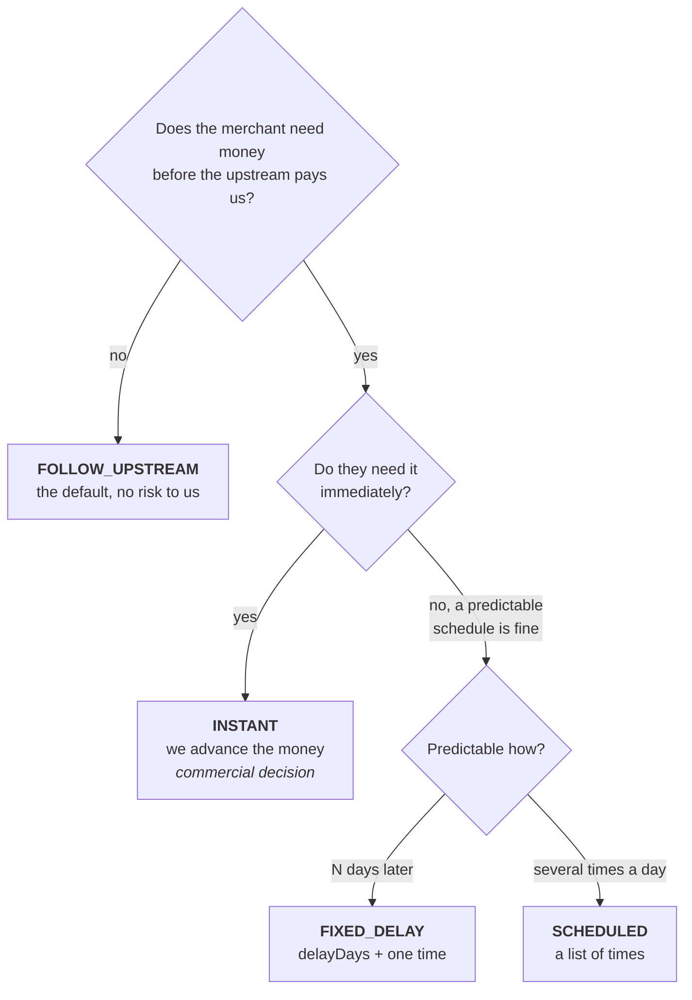

# Merchant Settlement Policy, Explained

No background assumed. This is the "what is actually going on" document for
`settlement.MerchantSettlementPolicy`, the four modes, and the pure function
that reads them.

Third in the set:

- [balance-explained.md](balance-explained.md) — the money model. What `PENDING`
  and `AVAILABLE` mean.
- [settlement-explained.md](settlement-explained.md) — the machinery. The claim,
  the batch, the enqueuer, the sweeper.
- **this one** — the rules. *When* a merchant's money should move.

You can read this one before the machinery document. It answers a business
question, and the business question is the easier half.

---

## 1. The one question this table answers

> **When does a merchant's money stop being "coming" and start being "theirs to
> spend"?**

That is the whole purpose of `MerchantSettlementPolicy`. Nothing else.

In the money model, every payment lands in the merchant's `PENDING` bucket —
theirs, but not spendable. Something has to decide when it moves to `AVAILABLE`.
That decision is not technical: it is a commercial term, negotiated per
merchant, and different merchants get different answers.

This table is where that term is written down so code can read it.

### Why it is not obvious

The tempting answer is "as soon as the payment succeeds". That is wrong for a
reason that has nothing to do with software:

**When a customer pays a merchant through us, we do not have the money yet.**
The customer paid MotionPay. MotionPay holds it and sends it to us *later* —
next day at 15:00 for QRIS, three days later for e-wallets. If we credited the
merchant's spendable balance the instant the payment succeeded, and the merchant
immediately withdrew it, we would be paying out money that is still sitting at
MotionPay.

So the honest default is: **the merchant's money becomes spendable once the
upstream has actually sent it to us.** That is the `FOLLOW_UPSTREAM` mode, and
it is the default for exactly this reason.

The other three modes exist because some merchants are offered different terms
— faster, for a fee, or on a fixed schedule they can plan around.

---

## 2. Why it is not just a number

Until this step, the whole thing was one integer:

```prisma
settlementInterval Int @default(120)   // minutes. Now deleted.
```

"Settle this merchant every 120 minutes." Four things that cannot say:

| What a merchant might actually get | Can `120` express it? |
|---|---|
| "You get paid the day after, once MotionPay pays us" | ❌ it has no idea when MotionPay pays |
| "You get paid T+2, at 10:00" | ❌ it has no concept of a time of day |
| "You get paid four times a day: 06:00, 12:00, 18:00, 23:00" | ❌ "every 360 minutes" drifts and does not land on those times |
| "QRIS is next-day but your e-wallet payments are T+3" | ❌ one number per merchant, not per method |

And one thing it expressed *badly*: "every 120 minutes" from **when**? From the
last run? From midnight? The answer was "from whenever the cron happened to
fire", which means no merchant could be told a time they would actually be paid.

So the integer becomes a small table with a **mode** — a named strategy — plus
the parameters that strategy needs.

---

## 3. The four modes

```prisma
enum SettlementModeEnum {
  INSTANT
  FOLLOW_UPSTREAM     // the default
  FIXED_DELAY
  SCHEDULED
}
```

Each one below says: the business situation, the columns it uses, and a concrete
timeline. All times are `Asia/Jakarta`.

### `FOLLOW_UPSTREAM` — the default, and the honest one

**The deal:** "You get your money once the provider has given it to us."

**Columns used:** none of its own. It reads
[`UpstreamSettlementWindow`](#10-follow_upstream-needs-a-second-table) for the
payment's provider and method.

**Timeline** — a QRIS payment, MotionPay's published schedule being T+1 at 15:00:

```
Tue 14 Oct 09:00   customer pays 100,000        → merchant PENDING +98,000
Tue 14 Oct 09:00   ...merchant can spend 0 of it
Wed 15 Oct 15:00   MotionPay settles to us      → merchant AVAILABLE +98,000
```

A payment at **23:50 on Tuesday** has the same release moment — Wednesday 15:00
— because the upstream settles by calendar day, not by elapsed hours.

**Why it is the default:** it is the only mode where we never advance money we
have not received. Every other mode is us taking on risk, deliberately.

### `FIXED_DELAY` — "T+N at a set time"

**The deal:** "You get paid two days after the payment, at 10:00."

**Columns used:** `delayDays` (required, whole number ≥ 0), and **exactly one**
entry in `releaseTimes`.

**Timeline** — `delayDays: 2`, `releaseTimes: ["10:00"]`:

```
Tue 14 Oct 09:00   customer pays           → PENDING
Thu 16 Oct 10:00   release                 → AVAILABLE
```

**The important subtlety: it counts calendar days, not 24-hour blocks.**

| Paid at | T+1 at 10:00 releases |
|---|---|
| Tue 00:01 | **Wed 10:00** |
| Tue 09:00 | **Wed 10:00** |
| Tue 23:59 | **Wed 10:00** |

All three land on the same moment. A merchant paid one minute before midnight
does **not** wait an extra day. This is deliberate — "T+1 at 10:00" is a promise
about a *date*, and a merchant should not get a different answer because a
customer paid late in the evening.

**The odd case worth knowing:** `delayDays: 0` with `releaseTimes: ["10:00"]`
and a payment at 23:59 gives a release moment of **10:00 that same day** —
already in the past, so the money is available immediately. That looks like a
bug and is not: T+0 at 10:00 for a payment made after 10:00 means "the release
time for your day has already gone, so there is nothing to wait for".

### `SCHEDULED` — "N times a day"

**The deal:** "You get paid in batches at 06:00, 12:00, 18:00 and 23:00."

**Columns used:** `releaseTimes` (one or more). `delayDays` is ignored.

**Timeline** — `releaseTimes: ["06:00","12:00","18:00","23:00"]`:

| Paid at | Next release at or after it | Available |
|---|---|---|
| Tue 05:00 | Tue 06:00 | Tue 06:00 |
| Tue 06:00 | Tue 06:00 | **Tue 06:00** — exactly on the boundary goes out *in* that batch |
| Tue 06:01 | Tue 12:00 | Tue 12:00 |
| Tue 23:59 | **Wed 06:00** | Wed 06:00 — past the last batch, rolls to tomorrow |

Order in the column does not matter; the code sorts it. `["23:00","06:00"]`
behaves identically to `["06:00","23:00"]`.

**`SCHEDULED` with one entry** is a daily cutoff: `["14:00"]` means "paid before
14:00 → today at 14:00; paid after → tomorrow at 14:00".

### `INSTANT` — "immediately"

**The deal:** "Your money is spendable the moment the payment succeeds."

**Columns used:** none.

```
Tue 14 Oct 09:00   customer pays   → PENDING and AVAILABLE in the same breath
```

**This mode is us lending the merchant money.** We credit them before MotionPay
has paid us, so between the payment and the upstream settlement, the merchant
could withdraw funds we are still waiting for. That is a real commercial risk,
not a technical one — fine for a trusted high-volume merchant, dangerous as a
default. It exists because some merchants need the liquidity and will pay for
it.

### `FIXED_DELAY` vs `SCHEDULED` — the distinction that trips people

They sound similar and answer different questions:

> - **`FIXED_DELAY` answers "how long does the merchant wait?"** — it delays by
>   **days**. One release per day.
> - **`SCHEDULED` answers "at what times do we release?"** — it batches **within
>   a day**. Several releases per day, no delay.

"Four batches a day" is `SCHEDULED`, not `FIXED_DELAY`. "T+2" is `FIXED_DELAY`,
not `SCHEDULED`. If a merchant ever needs *both* — "T+2, released in four
batches" — neither mode expresses it today, and that is a deliberate gap rather
than an oversight.

---

## 4. Which mode for which merchant



Default to `FOLLOW_UPSTREAM` unless someone has explicitly negotiated otherwise.
`registerMerchant` already does this — every new merchant gets a
`FOLLOW_UPSTREAM` row on `'*'`.

---

## 5. The column matrix

This is where most mistakes happen. The database cannot enforce "if the mode is
`FIXED_DELAY` then `delayDays` must be set", so the **settlement runner throws
instead** — at 2am, on one merchant.

| Column | `INSTANT` | `FOLLOW_UPSTREAM` | `FIXED_DELAY` | `SCHEDULED` |
|---|---|---|---|---|
| `delayDays` | ignored | ignored | **required**, whole, ≥ 0 | ignored |
| `releaseTimes` | ignored | ignored | **exactly one** | **one or more** |
| `businessDaysOnly` | must be `false` | must be `false` | must be `false` | must be `false` |
| needs a window row | no | **yes** | no | no |

The exact refusals, from
[policy.eligibility.ts](../../apps/settlement/src/policy/policy.eligibility.ts):

```
settlement: FIXED_DELAY needs a whole-number delayDays, got null
settlement: FIXED_DELAY delayDays cannot be negative, got -1
settlement: FIXED_DELAY needs one entry in releaseTimes, got none
settlement: SCHEDULED needs at least one entry in releaseTimes, got none
settlement: FOLLOW_UPSTREAM needs the UpstreamSettlementWindow for this
            payment's provider and method. Resolve it before calling.
settlement: businessDaysOnly is set on this policy, but the business-day
            calendar is not implemented. Refusing to settle rather than
            release funds on a day the policy says to skip.
```

**`businessDaysOnly` refuses outright today.** The column exists, the holiday
calendar does not, and no partner has told us their holiday policy. Treating the
flag as `false` would release funds on a public holiday while whoever ticked it
believes otherwise — so the code fails loudly instead. Failing one merchant's
run is recoverable; paying early is not. **Do not expose that checkbox in the
admin UI yet.**

---

## 6. Times, and the timezone story

`releaseTimes` entries must be **zero-padded, 24-hour `HH:mm`**. The pattern is
`^([01]\d|2[0-3]):([0-5]\d)$`, so all of these are rejected:

| Value | Why |
|---|---|
| `"7:00"` | not zero-padded |
| `"24:00"` | 24 is not an hour |
| `"12:60"` | 60 is not a minute |
| `"10:00:00"` | seconds are not part of the format |
| `""` | empty |

The padding is not fussiness: zero-padded `HH:mm` sorts **chronologically as
plain text**, which is how the code finds "the next release time" without
parsing anything. `"06:00" < "12:00" < "18:00"` as strings. Drop the padding and
`"6:00" > "12:00"`, which would silently pick the wrong batch.

### Everything on this table is Jakarta time

There is **no timezone column** on `MerchantSettlementPolicy`, and that is
deliberate. A merchant's settlement schedule is a contractual term in local
Indonesian time. It does not change because a container was redeployed to a
different region.

The code uses a module constant, not `process.env.TIMEZONE`:

```ts
const SETTLEMENT_TIMEZONE = 'Asia/Jakarta';
```

Reading the environment would make the same inputs produce different answers per
deployment, which for a pure function is a bug waiting to happen. (The
dashboard's `DateHelper` *does* read the environment — different job, different
tradeoff.)

`UpstreamSettlementWindow` **does** have a `timezone` column, because a
partner's published schedule is in *their* timezone and that is theirs to state.

---

## 7. `paymentMethodName` is `'*'`, not `NULL`

```prisma
paymentMethodName String @default("*")   // NOT NULL
```

`'*'` means **"this merchant's default — every payment method"**. A real method
name (`QRIS`, `DIRECTEWALLET`, …) means **"an override, just for this method"**.

So a merchant can have:

| merchantId | paymentMethodName | mode | meaning |
|---|---|---|---|
| 27 | `*` | `FOLLOW_UPSTREAM` | everything, unless overridden |
| 27 | `QRIS` | `FIXED_DELAY` T+1 10:00 | QRIS specifically |

A QRIS payment uses the second row. Any other method uses the first.

### Why not `NULL` for "default"?

`NULL` reads better in English and it was written that way first. It made the
unique constraint a lie.

Postgres treats `NULL`s as **distinct** in a unique index, so
`@@unique([merchantId, paymentMethodName, effectiveFrom])` would *not* stop two
rows that are both `NULL` on the method. Measured on the real database before
the fix:

```
pg=17.4  indnullsnotdistinct=f
rowsWithNullMethod=2        ← both inserts succeeded
nonNullDup=REJECTED         ← the same pair with 'QRIS' collided correctly
```

Two default policies for one merchant, both active, and "most specific wins" has
no single answer — it would pick whichever the database happened to return
first, which can change between queries. With `'*'` the constraint actually
fires.

**For the admin UI this means a form must submit `'*'`, not an empty field.**

---

## 8. Effective dating — and the query everyone gets backwards

```prisma
effectiveFrom DateTime  @db.Timestamptz(6)   // when this term came into force
effectiveTo   DateTime? @db.Timestamptz(6)   // when it stopped. NULL = still in force
```

### Why not just edit the row?

Because a batch that ran last month ran under last month's terms, and changing a
merchant's policy today must not rewrite what should have happened then. If you
`UPDATE` the row in place, the record of the old term is gone — and the first
time someone asks "why was this merchant paid T+1 in September when their
contract says T+2?" there is nothing to answer with.

So changing a policy is **two rows, not an edit**:

Merchant 27 moves from `FOLLOW_UPSTREAM` to `FIXED_DELAY` on 1 November:

| id | mode | effectiveFrom | effectiveTo | in force |
|---|---|---|---|---|
| 88 | `FOLLOW_UPSTREAM` | 1 Sep | **1 Nov** | Sep and Oct |
| 94 | `FIXED_DELAY` T+1 | **1 Nov** | `NULL` | 1 Nov onward |

A batch replaying October reads row 88 and gets October's terms. A batch running
today reads row 94. Both answers are correct, and they stay correct — which is
only possible because row 88 was never overwritten.

Retire the old row by setting its `effectiveTo`, insert the new one — **in one
transaction**, or a reader can briefly see two active policies or none.

### The query, and the two ways to get it wrong

A policy is **in force at `now`** when:

```
effectiveFrom <= now   AND   (effectiveTo IS NULL  OR  effectiveTo > now)
```

In Prisma:

```ts
where: {
  deletedAt: null,
  effectiveFrom: { lte: now },
  OR: [{ effectiveTo: null }, { effectiveTo: { gt: now } }],
}
```

Two mistakes are extremely easy to make here, and both return **zero rows,
always** — no error, no warning, just an empty list and an enqueuer that never
enqueues anything:

**Mistake 1 — the comparisons inverted.**

```ts
effectiveFrom: { gte: now },   // ✗ "comes into force in the future"
effectiveTo:   { lte: now },   // ✗ "stopped being in force in the past"
```

Read that out loud: *"give me policies that start later and already ended."*
Nothing can satisfy both. The right way round is `effectiveFrom` **`lte`** (it
has already started) and `effectiveTo` **`gt`** (it has not ended yet).

**Mistake 2 — forgetting `effectiveTo` is nullable.**

```ts
effectiveTo: { lte: now },     // ✗ silently drops every NULL
```

A comparison against `NULL` is never true in SQL, so this filters out every row
whose `effectiveTo` is `NULL` — which is **every currently-active policy**,
since that is exactly what `NULL` means here. The `OR: [{ effectiveTo: null },
…]` is not defensive padding; it is the main case.

A quick way to sanity-check your own query: run it, and if a brand-new merchant
registered five minutes ago does not appear, the filter is wrong.

---

## 9. Resolution — most specific wins

Given a payment, which policy applies? Most specific first, then most recent:

```sql
SELECT * FROM "settlement"."MerchantSettlementPolicy"
WHERE "merchantId" = $1
  AND "paymentMethodName" IN ($2, '*')         -- the method, or the default
  AND "effectiveFrom" <= now()
  AND ("effectiveTo" IS NULL OR "effectiveTo" > now())
  AND "deletedAt" IS NULL
ORDER BY ("paymentMethodName" = '*'), "effectiveFrom" DESC
LIMIT 1;
```

The `ORDER BY` deserves a second look. `("paymentMethodName" = '*')` is a
boolean, and Postgres sorts `false` before `true` — so an **exact method match
sorts first** and `'*'` only wins when there is no override. Then
`effectiveFrom DESC` breaks any remaining tie in favour of the most recently
effective row.

Worked example — merchant 27 has both rows from §7, and a `QRIS` payment
arrives:

| Candidate | `paymentMethodName = '*'` | sorts |
|---|---|---|
| the `QRIS` override | `false` | **first** ✅ |
| the `*` default | `true` | second |

A `DIRECTEWALLET` payment from the same merchant matches only the `'*'` row,
because `DIRECTEWALLET` is not in `($2, '*')` for that row — so the default
applies.

### No policy at all

A merchant with no matching row is treated as `FOLLOW_UPSTREAM`. That keeps any
merchant registered before this table existed from being stranded unpaid.

It is a fallback, not the normal path: `registerMerchant` creates an explicit
row, and an explicit row is what makes a merchant's terms **visible and editable
in the admin UI** instead of implied by a default buried in code.

---

## 10. `FOLLOW_UPSTREAM` needs a second table

The other three modes are self-contained — everything they need is on the policy
row. `FOLLOW_UPSTREAM` is different: it depends on what a *partner* does, which
is not a property of the merchant at all.

```prisma
model UpstreamSettlementWindow {
  providerName      String      // MOTIONPAY
  paymentMethodName String      // QRIS
  label             String      // "DAILY", "BATCH_1", "BATCH_2"
  settlementOffset  Int         // 0 same day, 1 = H+1, 3 = H+3
  settlementTime    String?     // "15:00", or NULL when the partner gives no time
  timezone          String      @default("Asia/Jakarta")
  effectiveFrom     DateTime
  effectiveTo       DateTime?
  @@unique([providerName, paymentMethodName, label, effectiveFrom])
}
```

Seeded today, from what MotionPay has actually published:

| Provider | Method | Offset | Time | Meaning |
|---|---|---|---|---|
| MOTIONPAY | QRIS | 1 | `15:00` | next day at 15:00 |
| MOTIONPAY | DIRECTEWALLET | 3 | `NULL` | three days later, no stated time |

**`settlementTime: NULL` means end of day, not start.** MotionPay's e-wallet
schedule is "H+3" with no hour attached. Releasing at 00:00 on H+3 would be us
paying the merchant before MotionPay plausibly paid us, so the code assumes
`23:59:59.999`. Pessimistic on purpose.

**One method can have several windows.** Teleanjar settles batch 1 at 13:00 and
batch 2 at 19:00, both in force from the same date — which is why `label` is in
the unique key. A screen or a seed assuming one window per provider+method will
not fit them.

**Choosing which window a payment falls into is not implemented yet**, and that
is deliberate: the partner doc records real open questions about the boundaries
(Teleanjar's 18:00 appears in *both* batches, and 12:00:01–12:00:59 belongs to
neither). Guessing would mean inventing an answer they have not given. For now
the code takes the window it is handed and uses `settlementOffset` +
`settlementTime` from the payment's own calendar day.

---

## 11. From a policy to the claim's `WHERE`

Here is the bridge to [settlement-explained.md](settlement-explained.md), and
the part that makes the whole thing click.

The policy is consulted **twice**, for two different purposes:

**1. The enqueuer** uses it to decide *when to create a run* — "merchant 27's
money is due at 15:00, write that down".

**2. The claim** uses it to decide *which rows to take* — because a run being
due does not mean every one of that merchant's transactions is ripe.

The two functions in `apps/settlement/src/policy/`:

```ts
settlementReleaseAt(payment, policy, window?) : Date      // the moment funds are released
isEligible(payment, policy, now, window?)     : boolean   // has that moment arrived?
```

`isEligible` is literally `now >= settlementReleaseAt(...)`. One rule, two
shapes — so the dashboard can show "funds available at" and agree with the
runner by construction rather than by a second implementation.

### Why the claim filters in SQL, not JavaScript

You cannot call `isEligible` row by row inside a query. So for the claim, the
policy is turned into a **cutoff timestamp** in JavaScript *first*, then passed
as a parameter:

| Mode | Cutoff passed to the claim |
|---|---|
| `INSTANT` | `now` — everything paid up to now is ripe |
| `FIXED_DELAY` | `startOfDay(now) - delayDays`, if `now` is past today's release time |
| `SCHEDULED` | the most recent release time that has passed |
| `FOLLOW_UPSTREAM` | derived from the window: `startOfDay(now) - settlementOffset`, if past `settlementTime` |

...and the claim becomes:

```sql
AND "paidAt" < $cutoff
```

Fetching every unsettled row of a busy merchant into memory just to discard most
of them is the alternative, and it does not scale.

`isEligible` is still the function of record — use it in tests, in the dashboard,
and anywhere you are checking one payment. The cutoff is an optimisation for the
one place that has to filter thousands of rows at once, and the two must agree.

That agreement is asserted rather than assumed: `policy.due-at.spec.ts` checks
that `paidAt < cutoff` and `isEligible` partition every payment identically
across eight policies, fourteen clock times and some three hundred payments,
plus a one-directional check that anything claimed is genuinely eligible. A
tight cutoff only delays a merchant; a generous one sends money that cannot be
recovered.

---

## 12. From a policy to a `dueAt`

The enqueuer's whole job. Every other document uses `dueAt`, indexes it, and
depends on its uniqueness — none of them says how to compute it. This is that
missing piece.

> **Shipped, not proposed.** `mostRecentDueAt` and `settlementCutoff` live in
> `apps/settlement/src/policy/policy.due-at.ts` (commit `eb88f32`), and the
> enqueuer that calls them is `614c81f`. Read this section as a description of
> what runs, with the reasoning kept because the reasoning is the part that is
> hard to recover from the code.

### What `dueAt` has to be

A **release boundary** — a scheduled moment, snapped to the policy — that has
already passed. Three requirements, all load-bearing:

1. **Deterministic.** The same logical boundary must always produce the same
   timestamp. This is what makes `@@unique([merchantId, paymentMethodName,
   dueAt])` work: the second pod computes the same value and loses the insert.
2. **At or before `now`.** The runner only picks up `dueAt <= now()`, so
   enqueueing a future boundary just creates a row nobody touches yet.
3. **One per boundary, ever.** Re-running the enqueuer must not produce a second
   run for the same boundary.

### The trap

```ts
dueAt: new Date()   // ← breaks all three, silently
```

Every tick computes a different value, so the unique key never collides, so
every tick inserts a new row. At a 10-minute cron that is **144 runs per
merchant per day** — each one claiming nothing, because the first already took
the work. Nothing errors. You just quietly accumulate junk and the real signal
("did settlement happen for merchant 27?") drowns.

`dueAt` for a `SCHEDULED` merchant at 15:07 is **today 12:00** — the boundary
that passed — not 15:07.

### The insight that collapses four cases into two

> **`dueAt` depends only on the release *times*. Never on `delayDays` or
> `settlementOffset`.**

That looks wrong at first. Work through `FIXED_DELAY` with `delayDays: 2`,
`releaseTimes: ["10:00"]`:

- A payment from Monday releases Wednesday 10:00.
- A payment from Tuesday releases Thursday 10:00.
- A payment from Wednesday releases Friday 10:00.

So **every day at 10:00, something becomes available.** The run fires daily at
10:00 regardless of the delay. The delay decides *which* payments are ripe —
and that is the eligibility cutoff's job (§11), not `dueAt`'s.

Same for `FOLLOW_UPSTREAM`: `settlementOffset: 3` does not mean "look every
three days". MotionPay settles *something* to us every day; the offset says the
something is three days old.

Which means:

| Mode | Boundary times | Derivation |
|---|---|---|
| `SCHEDULED` | `releaseTimes` | most recent that has passed |
| `FIXED_DELAY` | `releaseTimes` (exactly one) | **identical to `SCHEDULED`** |
| `FOLLOW_UPSTREAM` | the window's `settlementTime` | same, in the **window's** timezone |
| `INSTANT` | none — see below | a truncated slot |

`FIXED_DELAY` and `SCHEDULED` share one code path. A single-entry list is just a
list.

### The derivation

```ts
/**
 * The most recent release boundary at or before `now`, or null when the policy
 * has no boundary yet (a brand-new policy whose first one is still ahead).
 *
 * Deterministic by construction: every branch returns a time snapped to the
 * schedule, never `now` itself.
 */
export function mostRecentDueAt(
  policy: EligibilityPolicy,
  now: Date,
  window?: EligibilityWindow,
): Date | null {
  switch (policy.mode) {
    case SettlementModeEnum.SCHEDULED:
    case SettlementModeEnum.FIXED_DELAY:
      return lastBoundaryAtOrBefore(policy.releaseTimes, SETTLEMENT_TIMEZONE, now);

    case SettlementModeEnum.FOLLOW_UPSTREAM: {
      if (!window) return null;             // nobody seeded this method's window
      // A null settlementTime means "end of day" - the same assumption
      // settlementReleaseAt makes, so the two cannot disagree.
      const times = [window.settlementTime ?? '23:59'];
      return lastBoundaryAtOrBefore(times, window.timezone, now);
    }

    case SettlementModeEnum.INSTANT:
      return currentSlot(now);              // see below
  }
}

/** The latest of `times` that has already happened, today or yesterday. */
function lastBoundaryAtOrBefore(
  times: readonly string[],
  zone: string,
  now: Date,
): Date | null {
  if (times.length === 0) return null;

  const sorted = [...times].sort();         // zero-padded HH:mm sorts correctly
  const at = DateTime.fromJSDate(now, { zone });
  const today = at.startOf('day');

  const passedToday = sorted
    .map((t) => atTimeOnDay(today, t))
    .filter((b) => b.toMillis() <= at.toMillis());

  if (passedToday.length > 0) {
    return passedToday[passedToday.length - 1].toJSDate();   // the latest one
  }

  // Nothing today yet - so the most recent boundary was yesterday's last.
  return atTimeOnDay(today.minus({ days: 1 }), sorted[sorted.length - 1]).toJSDate();
}
```

Worked through, for `releaseTimes: ["06:00","12:00","18:00","23:00"]`:

| `now` | boundaries passed today | `dueAt` |
|---|---|---|
| 05:30 | none | **yesterday 23:00** |
| 06:00 | 06:00 | **today 06:00** |
| 15:07 | 06:00, 12:00 | **today 12:00** |
| 23:59 | all four | **today 23:00** |

Notice 05:30 reaching back to yesterday. That is not an edge case to tolerate —
it is the correct answer. At 05:30 the most recent thing that should have been
settled is last night's 23:00 batch.

### `INSTANT` — the honest answer is that it does not fit

`INSTANT` means "available the moment the payment succeeds". There is **no
schedule**, so there is no boundary, so there is nothing deterministic to use as
`dueAt`. The model genuinely has no slot for it.

Three ways out, and the trade is real:

**A — Truncate `now` into fixed slots. Recommended.**

```ts
const INSTANT_SLOT_MINUTES = 10;

function currentSlot(now: Date): Date {
  const at = DateTime.fromJSDate(now, { zone: SETTLEMENT_TIMEZONE });
  const minute = Math.floor(at.minute / INSTANT_SLOT_MINUTES) * INSTANT_SLOT_MINUTES;

  return at.set({ minute, second: 0, millisecond: 0 }).toJSDate();
}
```

Both pods in the same slot compute the same timestamp, so the unique key still
works and the enqueuer stays idempotent. It is really `SCHEDULED` with a
boundary every ten minutes.

- ✅ one pipeline — batches, exports and audit all behave identically
- ✅ no new code path to get wrong
- ⚠️ "instant" is actually "within ten minutes", and 144 runs per merchant per
  day. Fine for a handful of merchants, not for thousands. Shorten the slot for
  a merchant who is genuinely paying for speed, and know it is a linear cost.

**B — Settle inline at capture, no run at all.** The purchase webhook posts
`PAYIN_CAPTURED` into `PENDING` and `MERCHANT_SETTLED` into `AVAILABLE` in the
same transaction. Truly instant, and the honest reading of the word.

- ⚠️ **Two settlement code paths**, one batched and one inline, doubling the
  surface where money bugs live.
- ⚠️ No `SettlementBatch` row, so instant merchants vanish from batch history
  and from the Step 13 export.

**C — Enqueue on demand**, a run inserted by the webhook. Event-driven, but
`dueAt` has the determinism problem all over again, and now the webhook depends
on settlement.

**A is what shipped**, as `INSTANT_SLOT_MINUTES = 10` in `policy.due-at.ts`. It
keeps one pipeline and one definition of "settled", and the ten minutes is a
product decision that can be revisited without touching the mechanism. Reach for
B only if a merchant is contractually promised sub-minute settlement — and
then accept the second code path deliberately rather than by accident.

### `FOLLOW_UPSTREAM` has to fan out, and that is why the run has a method

Here is the thing that explains a column you may have wondered about.

A `'*'` policy means "all methods". For the other three modes that is fine — the
boundary is merchant-wide, so one run with `paymentMethodName = '*'` covers
everything, and the claim's `($method = '*' OR "paymentMethodName" = $method)`
does the rest.

`FOLLOW_UPSTREAM` cannot work that way. Boundaries come from the **window**, and
windows are per `(provider, method)`:

| Method | Window | Boundary |
|---|---|---|
| QRIS | T+1 at 15:00 | daily 15:00 |
| DIRECTEWALLET | H+3, no time | daily end of day |

One run cannot carry both, because the claim's cutoff is a single
`AND "paidAt" < $cutoff`. Settle them together and you either release e-wallet
money two days early or hold QRIS money back.

So the enqueuer **expands a `'*'` FOLLOW_UPSTREAM policy into one run per
method that has a window** — `runsFor` in `enqueuer.service.ts`. Two windows
for one method is ambiguous rather than a choice to make, so it logs and skips;
`SettlementService` refuses the same case from the other side:

```
SettlementRun
 merchantId | paymentMethodName | dueAt
 27         | QRIS              | today 15:00
 27         | DIRECTEWALLET     | today 23:59:59.999
```

Each run then claims only its own method, with its own cutoff. That is what
`paymentMethodName` on `SettlementRun` is *for* — it is not a copy of the
policy's column, it is the resolved method the run is about.

A policy naming a specific method produces one run for that method, unchanged.

### No backfill, ever

If the enqueuer is down for three days, it must **not** create three days of
missed runs on restart. Only the most recent boundary.

This is the payoff of claiming instead of windowing (§4 of
[settlement-explained.md](settlement-explained.md)). A missed boundary is not
lost work: the transactions it would have claimed are still `NULL`, so the next
run sweeps up everything, including three days of backlog, in one go. Backfilling
would create runs that each claim nothing and bury the real one.

The same reasoning kills "catch-up" logic generally. The claim is cumulative, so
being late costs nothing but latency.

### Clamp to `effectiveFrom`

`lastBoundaryAtOrBefore` can reach back to yesterday, which may be **before the
policy came into force** — likely for a merchant who registered this morning.

Skip those: a run dated before its policy existed is confusing to read and
claims transactions under terms that were not yet agreed. One line:

```ts
if (dueAt && dueAt < policy.effectiveFrom) continue;
```

### Putting it together

```ts
@Cron(CronExpression.EVERY_10_MINUTES, { name: 'enqueuer', waitForCompletion: true })
async enqueueDueRuns(): Promise<void> {
  const now = new Date();
  const policies = await this.prismaMaster.merchantSettlementPolicy.findMany({
    where: {
      deletedAt: null,
      effectiveFrom: { lte: now },
      OR: [{ effectiveTo: null }, { effectiveTo: { gt: now } }],
    },
  });

  const rows: { merchantId: number; paymentMethodName: string; dueAt: Date;
                createdBy: number }[] = [];

  for (const policy of policies) {
    for (const { paymentMethodName, window } of await this.resolveTargets(policy)) {
      const dueAt = mostRecentDueAt(policy, now, window);
      if (!dueAt) continue;                        // no boundary yet
      if (dueAt < policy.effectiveFrom) continue;  // predates the terms

      rows.push({
        merchantId: policy.merchantId,
        paymentMethodName,
        dueAt,
        createdBy: SETTLEMENT_RUNNER_USER_ID,
      });
    }
  }

  if (rows.length === 0) return;

  // One statement, and duplicates are the normal case rather than an error:
  // the other pod's tick, and this pod's previous tick for an unchanged
  // boundary, both collide on @@unique([merchantId, paymentMethodName, dueAt]).
  const { count } = await this.prismaMaster.settlementRun.createMany({
    data: rows,
    skipDuplicates: true,
  });

  if (count > 0) this.logger.log({ msg: 'runs enqueued', count });
}
```

`resolveTargets(policy)` is the fan-out: `[{ paymentMethodName: policy.paymentMethodName }]`
for the three scheduled modes, and one entry per in-force window for
`FOLLOW_UPSTREAM` on `'*'`.

Two details the shipped version adds. `mostRecentDueAt` can throw —
`businessDaysOnly` is the live case — so each policy is wrapped individually:
one misconfigured merchant must not stop every other merchant being enqueued.
And the `@Cron` carries `waitForCompletion: true`, like the runner and sweeper,
because `@Cron` does not await the previous invocation.

**`skipDuplicates: true` rather than catching `P2002` per row.** Step 11
suggests the catch, which works but needs a loop of individual inserts.
`createMany` does it in one statement, and here a duplicate is the *expected*
outcome on most ticks — the boundary has not moved since the last one.

---

## 13. End-to-end scenarios

A payment captured **Tue 14 Oct at 23:59**, 100,000 gross / 98,000 net to the
merchant. What each policy does with it:

| Policy | Release moment | Merchant can spend it |
|---|---|---|
| `INSTANT` | Tue 14 Oct 23:59 | immediately |
| `FOLLOW_UPSTREAM` + MotionPay QRIS | Wed 15 Oct 15:00 | next afternoon |
| `FOLLOW_UPSTREAM` + MotionPay e-wallet | Fri 17 Oct 23:59:59.999 | three days later, end of day |
| `FIXED_DELAY` 1 @ `10:00` | Wed 15 Oct 10:00 | next morning |
| `FIXED_DELAY` 2 @ `10:00` | Thu 16 Oct 10:00 | two mornings later |
| `FIXED_DELAY` 0 @ `10:00` | Tue 14 Oct 10:00 | immediately — the time already passed |
| `SCHEDULED` `["06:00","12:00","18:00","23:00"]` | Wed 15 Oct 06:00 | past the last batch, so tomorrow's first |
| `SCHEDULED` `["23:00"]` | Wed 15 Oct 23:00 | paid at 23:59, after the 23:00 batch |

The same payment, under eight configurations, produces eight different answers
spanning three days. That spread is the reason this table exists instead of a
number.

---

## 14. How to check it yourself

### Who has what policy right now?

```sql
SELECT "merchantId", "paymentMethodName", "mode",
       "delayDays", "releaseTimes", "effectiveFrom", "effectiveTo"
FROM "settlement"."MerchantSettlementPolicy"
WHERE "effectiveFrom" <= now()
  AND ("effectiveTo" IS NULL OR "effectiveTo" > now())
  AND "deletedAt" IS NULL
ORDER BY "merchantId", ("paymentMethodName" = '*'), "paymentMethodName";
```

### Is any merchant going to make the runner throw?

Catching a misconfigured policy here beats catching it at 2am:

```sql
SELECT "id", "merchantId", "paymentMethodName", "mode", "delayDays",
       "releaseTimes", "businessDaysOnly"
FROM "settlement"."MerchantSettlementPolicy"
WHERE "deletedAt" IS NULL
  AND ("effectiveTo" IS NULL OR "effectiveTo" > now())
  AND (
        "businessDaysOnly" = true
     OR ("mode" = 'FIXED_DELAY' AND ("delayDays" IS NULL OR "delayDays" < 0
                                     OR array_length("releaseTimes", 1) <> 1))
     OR ("mode" = 'SCHEDULED'   AND coalesce(array_length("releaseTimes", 1), 0) = 0)
     OR EXISTS (SELECT 1 FROM unnest("releaseTimes") t
                 WHERE t !~ '^([01][0-9]|2[0-3]):[0-5][0-9]$')
  );
```

**Should return zero rows.** Anything here will throw when its merchant is
settled. Worth running as a check after any admin edit.

### Does any merchant have two active policies for the same thing?

```sql
SELECT "merchantId", "paymentMethodName", count(*)
FROM "settlement"."MerchantSettlementPolicy"
WHERE "deletedAt" IS NULL
  AND "effectiveFrom" <= now()
  AND ("effectiveTo" IS NULL OR "effectiveTo" > now())
GROUP BY 1, 2
HAVING count(*) > 1;
```

**Should return zero rows.** The unique key stops *identical* `effectiveFrom`
values, but not two rows with overlapping date ranges — that invariant is the
application's job, and this query is how you check it held.

### Is a `FOLLOW_UPSTREAM` merchant missing their window?

```sql
SELECT DISTINCT p."merchantId", p."paymentMethodName"
FROM "settlement"."MerchantSettlementPolicy" p
WHERE p."mode" = 'FOLLOW_UPSTREAM'
  AND p."deletedAt" IS NULL
  AND ("effectiveTo" IS NULL OR "effectiveTo" > now())
  AND p."paymentMethodName" <> '*'
  AND NOT EXISTS (
    SELECT 1 FROM "settlement"."UpstreamSettlementWindow" w
    WHERE w."paymentMethodName" = p."paymentMethodName"
      AND w."deletedAt" IS NULL
  );
```

A row here is a merchant whose settlement will throw with *"FOLLOW_UPSTREAM
needs the UpstreamSettlementWindow"* — because nobody seeded that method's
schedule. (The `'*'` rows are excluded because their method depends on the
payment, so this query cannot judge them.)

---

## 15. Vocabulary

| Term | Meaning here |
|---|---|
| **Policy** | One row: this merchant, this method, from this date, settles like this |
| **Mode** | The named strategy: `INSTANT`, `FOLLOW_UPSTREAM`, `FIXED_DELAY`, `SCHEDULED` |
| **Release moment** | The exact instant a payment's funds become spendable |
| **Eligible / ripe** | A payment whose release moment has passed |
| **`'*'`** | The sentinel for "this merchant's default, every method" |
| **Override** | A policy row naming a specific method, which beats the `'*'` row |
| **Effective dating** | `effectiveFrom` / `effectiveTo` — terms have a lifespan, and changing them means a new row |
| **In force** | `effectiveFrom <= now AND (effectiveTo IS NULL OR effectiveTo > now)` |
| **Window** | `UpstreamSettlementWindow` — what a *partner* published about when they pay us |
| **Offset** | `settlementOffset` — whole days from the payment's date to the partner's settlement |
| **Cutoff** | A release moment turned into a timestamp the claim's `WHERE` can compare `paidAt` against |
| **T+N** | N days after the transaction. `FIXED_DELAY` with `delayDays: N` |
| **H+N** | The same idea in a partner's wording, used by `UpstreamSettlementWindow` |
